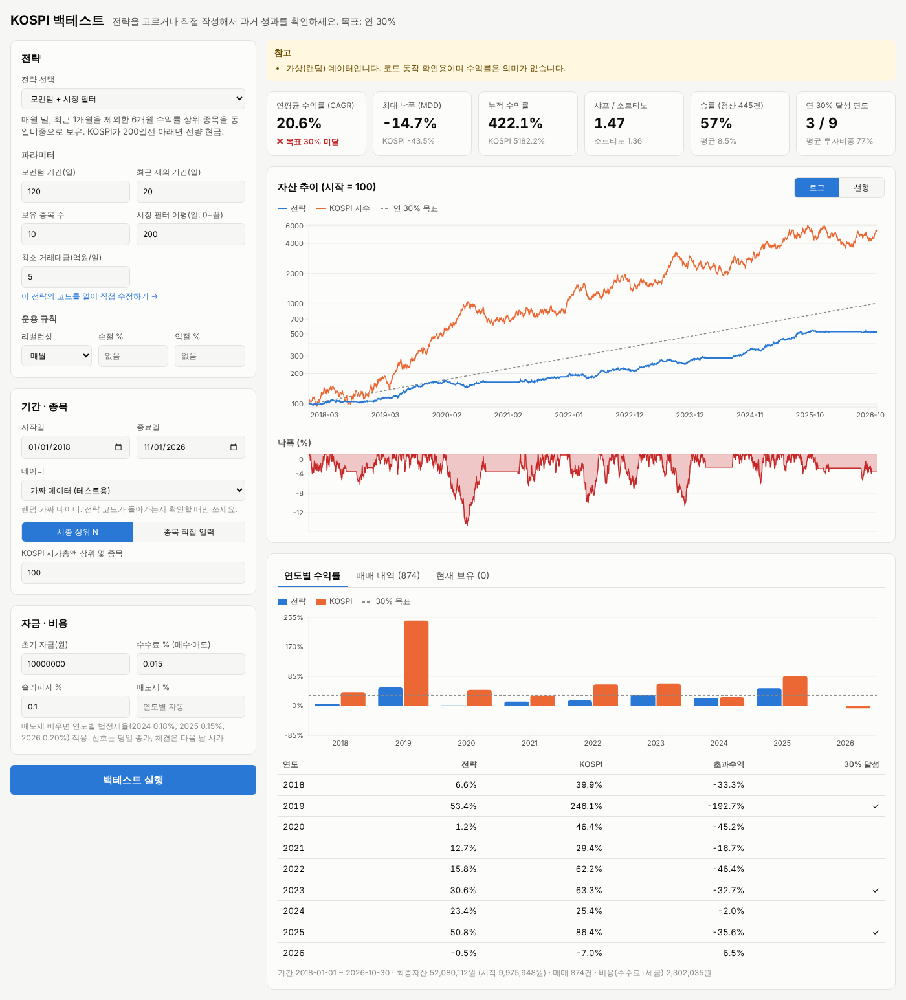

# alphy — KOSPI 백테스트 웹

브라우저에서 전략을 고르거나 직접 코드로 작성해 KOSPI 종목 과거 성과를 확인하는 웹 서비스입니다.
Next.js 15 + TypeScript. 백테스트 계산은 브라우저에서, 시세 수집은 서버(API 라우트)에서 합니다.

## 실행
Node.js 20 이상이 필요합니다.
```bash
npm install
npm run dev          # 개발 모드 → http://localhost:3000
# 또는
npm run build && npm start
npm test             # 엔진·데이터·KIS·설정 테스트
```

**한국투자증권 API:** 시세 수집과 모의투자 주문·잔고(`/trade`). 앱키·주문 대상·백테스트 기본값은 웹 설정 화면(`/settings`)에서 넣습니다 → [docs/kis.md](docs/kis.md)

**Synology NAS:** main 머지 시 GitHub Actions → GHCR → Watchtower로 자동 배포됩니다. 설정은 [docs/synology.md](docs/synology.md).

## 화면 구성
- **전략**: 기본 제공 5개(모멘텀+시장필터, 이동평균 정배열, RSI 과매도 반등, 신고가 돌파, 저변동성+추세) 중 선택하고 파라미터 조절
- **내 전략 (조건 고르기)**: 코드 없이 만듭니다. 시장 필터(KOSPI 이평선), 거르기 조건(수익률·이평선 대비 주가·RSI·변동성·거래대금·최고가 대비 등에 "이상/이하"), 줄 세우는 기준과 종목 수를 고르면 전략이 됩니다. "코드 작성"을 누르면 같은 내용이 코드로 바뀌어 이어서 고칠 수 있습니다
- **내 전략 (코드 작성)**: JavaScript 코드로 직접 작성. "이 전략의 코드를 열어 직접 수정하기"로 기본 전략을 복사해서 시작할 수 있습니다. 저장하면 NAS(`nas/cache/config/users/owner/strategies.json`)에 보관되어 어느 기기에서나 고를 수 있고(저장·삭제는 로그인 필요), 로그인하지 않았으면 그 브라우저에만 저장됩니다
- **운용 규칙**: 리밸런싱 주기(매일/매주/매월/분기), 손절·익절 %
- **추천 종목**: 결과의 "추천 종목" 탭에 마지막 날 종가 기준으로 전략이 고른 종목과 목표 비중이 나옵니다. "이 비중으로 주문 목록 만들기"를 누르면 주문 화면(`/trade`)에서 내 잔고와 비교해 살 종목·팔 종목 목록을 만들고, 확인 후 한 번에 주문합니다
- **결과**: CAGR·MDD(목표 달성 여부. 기본 연 15%, 낙폭 -25% 이내이고 `/settings`에서 바꿈), 샤프, 승률, 자산 곡선(KOSPI·목표선 비교), 낙폭, 연도별 수익률, 매매 내역(CSV 다운로드), 현재 보유 종목

## 내 전략 코드 작성법
장 마감 후 호출되며 `{ 종목코드: 비중 }`을 반환하면 다음 영업일 시가에 그 비중으로 매매합니다.
`{}`는 전량 현금, `null`은 이번엔 매매 안 함입니다.
```js
// 20일 수익률 상위 p.k 종목 동일비중, KOSPI 120일선 아래면 현금
if (ctx.bench() < ctx.benchSma(120)) return {};
return ctx.equal(ctx.topBy((t) => ctx.ret(t, 20), p.k));
```
사용 가능한 함수: `close/open/high/low/volume(t, ago)`, `ret(t, n, skip)`, `sma`, `rsi`, `volatility`,
`highest/lowest`, `tradingValue`, `bench/benchSma`, `held()`, `weight(t)`, `pnl(t)`, `topBy`, `equal`.
전체 목록은 `lib/engine/context.ts`. 미래 데이터는 구조적으로 조회할 수 없습니다.

## 데이터
| 소스 | 설명 |
|---|---|
| 네이버 증권 | 일봉(수정주가)과 KOSPI 시총 순위. `.cache/`에 저장하고 새 날짜만 이어 받음 |
| 한국투자증권 API | 일봉(수정주가)·KOSPI 지수. 앱키 필요, 시총 순위는 네이버 사용 ([docs/kis.md](docs/kis.md)) |
| 내 CSV | `data/csv/{종목코드}.csv`, 지수는 `KOSPI.csv` |
| 가짜 데이터 | 랜덤 데이터. 코드 동작 확인용 |

**미국 주식:** '종목 직접 입력'에 티커(AAPL, SPY, BRK.B)를 넣으면 한국 종목과 섞어 쓸 수 있습니다.
- 데이터를 '한국투자증권 API'로 고르면 미국 시세(해외주식 기간별시세의 원래 가격에 액면분할만 반영, 배당은 가격에 넣지 않고 현금으로 따로 계산)·원/달러 환율·S&P 500 도 한국투자증권에서 받고, 못 받거나 과거 기간이 모자라면 종목별로 야후 파이낸스로 넘어갑니다. 실서버 확인은 `/api/diag/kis` 의 usDaily·usHistory·fx·sp500 단계.
- 그 밖에는 야후 파이낸스 일봉(액면분할 반영, 배당 미포함)을 받아 그날 원/달러 환율(야후 `KRW=X`, 환율 없는 날은 직전 값)로 **원화로 바꿔** 계산합니다. 환율 변동이 수익률에 들어갑니다.
- 비용: 거래세 없음, 수수료(기본 0.25%)와 환전 비용(기본 0.1%, 살 때·팔 때 각각)은 화면·설정에서 바꿀 수 있습니다. 양도소득세(연 250만 원 넘는 차익의 22%)는 계산하지 않습니다.
- 미국 종목만 넣으면 비교 지수는 S&P 500(원화 환산), 섞으면 KOSPI.
- 휴일이 다른 종목을 섞으면, 휴장일에는 직전 종가로 채우고 매매하지 않습니다. 신호는 그날 두 시장이 모두 마감한 뒤(한국 시간 다음 날 아침), 체결은 각 시장의 다음 거래일 시가입니다.
- 종목 이름(한글)은 한국투자증권 해외 종목 마스터(`lib/data/usMaster.ts`)에서 받습니다. 주문 화면의 "전략대로 맞추기"는 아직 국내 주문만 되어 미국 종목은 빠집니다.

**생존편향:** 기본 종목 목록은 '현재' 시총 상위라서 과거에 상장폐지된 종목이 빠지고, 성과가 실제보다 좋게 나옵니다.
"과거 시점의 시총 상위 종목 사용"을 켜면 분기마다 그 시점의 시총 상위 종목으로 목록을 바꾸고(KRX 정보데이터시스템), 상장폐지된 종목도 포함합니다.
KRX 를 못 쓰는 환경이면 `data/csv/universe.csv`(`date,code,name`)에 시점별 목록을 직접 넣고 "내 CSV"로 돌릴 수 있습니다.

## 검증 (과최적화 점검)
결과의 "검증" 탭에서 확인합니다.
- **앞 기간과 뒤 기간**: 앞 70%와 뒤 30%의 CAGR·MDD·샤프를 따로 보여 줍니다. 파라미터는 앞 구간만 보고 정하고 뒤 구간은 마지막에 한 번만 확인하세요
- **1년 보유 수익률 분포**: 아무 날에 시작해 1년 뒤 목표 수익률 이상이었던 비율, 가장 나빴던 1년
- **파라미터 민감도**: 숫자 파라미터를 하나씩 ±20% 바꿔 다시 돌린 결과. 조금 바꿨는데 크게 떨어지면 우연히 맞은 값입니다

## 가정
- 신호: t일 종가 → 체결: t+1일 시가, 정수 주, 매도 후 매수
- 수수료 0.015%(양방향), 슬리피지 0.1%, 매도세 연도별(2024 0.18%, 2025 0.15%, 2026 0.20%) — `lib/engine/costs.ts`
- 거래정지(거래량 0) 종목은 그날 매매하지 않음
- 시세가 끊긴 뒤 10영업일 넘게 다시 나오지 않는 종목은 상장폐지로 보고 마지막 종가에 청산
- 보유 비중 차이가 2%p 미만이면 수량 조정 생략(불필요한 비용 방지)

## 구조
```
app/page.tsx              입력 화면
components/Results.tsx    결과 차트·표
app/api/data/route.ts     데이터 API
lib/engine/               엔진(engine, context, metrics, costs, indicators)
lib/strategies/index.ts   기본 전략 + 사용자 코드 컴파일
lib/data/                 네이버 수집, 캐시, CSV, 가짜 데이터
lib/kis/                  한국투자증권 API (토큰, 시세, 주문, 잔고)
app/trade/page.tsx        주문·잔고 화면
tests/engine.test.ts      테스트
```



Python 버전(pykrx/FinanceDataReader 기반 CLI)은 `python/` 폴더에 있습니다.

## 보안 · 밖에서 접속
앱 전체가 관리자 로그인 뒤에 있습니다(`middleware.ts`). 처음 접속하면 컨테이너 로그의 설정 코드로 비밀번호를 만들고,
설정 → 보안에서 2단계 인증(휴대폰 인증 앱), 최근 로그인 기록, 모든 기기 로그아웃을 관리합니다.

**가족·지인 초대**: 설정 → 사용자에서 1회용 초대 링크(3일 유효)를 만들어 보내면 그 사람이 아이디·비밀번호를 정해 가입합니다. 사람마다 로그인·2단계 인증·전략 보관함·마지막 설정이 따로이고(`nas/cache/config/users.json`, `users/<아이디>/`), 서버 설정은 처음 만든 관리자(owner) 계정만 바꿉니다. 한국투자증권은 각자 본인 설정 화면에서 본인 앱키·계좌를 넣어 쓰고(`users/<아이디>/kis.json` 에 암호화 저장), 처음에는 모의투자만 됩니다. 다른 사람의 실전 주문은 ① 서버의 `KIS_ALLOW_REAL_ORDERS=yes` ② owner 가 설정 → 사용자에서 "실전 허용" ③ 그 사람의 2단계 인증이 모두 있어야 나갑니다. 암호화 키는 자동으로 만들어지며(`secret.key`), NAS `.env` 에 `ALPHY_SECRET_KEY` 를 넣으면 설정 폴더 복사본만으로는 풀 수 없게 됩니다.
인터넷에서 `https://alphy.devsean.me` 로 여는 방법(DSM 역방향 프록시, 인증서, 공유기, 방화벽)은 [docs/external-access.md](docs/external-access.md).
